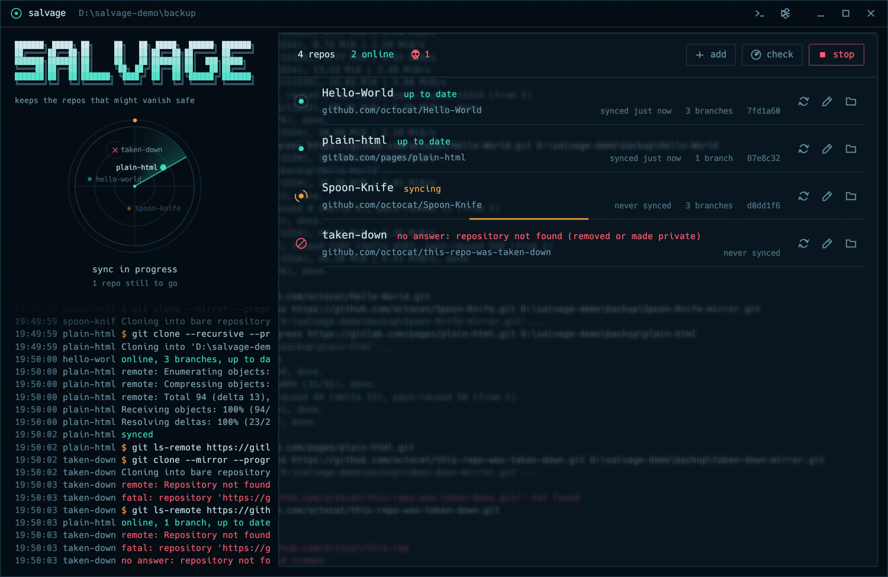

# Salvage

Keeps local backups of git repos that might vanish.

Give it a list of git links. For each one it keeps a full mirror (every branch
and tag) and a normal working copy with submodules, and it keeps both up to
date. When a repo is taken down or moves to another host, you still have
everything, and you can point the backup at the new link in two clicks.



## What it does

- **Any git host.** GitHub, GitLab, Gitea/Forgejo, a self-hosted server: if
  `git` can clone it, Salvage can back it up.
- **Tells you what is still alive.** At startup it asks every link whether it
  still answers. Green means up to date, orange means there is something to
  download, a red skull means the link is dead (your backup stays on disk).
- **Syncs on a timer.** Every N hours while the window is open, or through the
  Windows Task Scheduler while it is closed. No service, nothing left running:
  Windows starts Salvage with no window, it syncs, it quits.
- **Follows a repo that moves.** Click the pencil, paste the new link. The
  folders on disk stay the same and the old link is kept in a history.
- **Never deletes anything.** Removing a repo from the list leaves its files.
  Re-cloning a working copy renames the old one to `Name.old-<date>`.
- **Shows its work.** Every git command and its output scrolls in the terminal
  behind the interface. Press `F2` to see it full screen.

On disk, under the backup folder you choose:

```
Name-mirror.git/   bare mirror: all branches, all tags
Name/              working copy, submodules included
```

Repos already in that folder are found and added on first run.

## Requirements

- Windows 10 or 11
- [`git`](https://git-scm.com/download/win) in your `PATH`

## Download

Grab `Salvage.exe` from the [latest release](https://github.com/Matteo842/salvage/releases/latest).
It is a single file, no installer. The exe is not signed, so Windows SmartScreen
may ask for confirmation the first time.

## Build and run

```
cargo build --release
target\release\salvage.exe --root "D:\backup"
```

`--root` is only needed the first time (you can also change the folder in the
settings). The list is stored in `%APPDATA%\Salvage\config.json`, and the log
of the last scheduled run in `%APPDATA%\Salvage\last-sync.log`.

The interface is in English, or in Italian on an Italian system. Set
`SALVAGE_LANG=en` or `SALVAGE_LANG=it` to force one.

## Built with

Rust and [egui](https://github.com/emilk/egui). The icon, the sonar and every
control are drawn in code; there are no image assets.

## License

[MIT](LICENSE)
